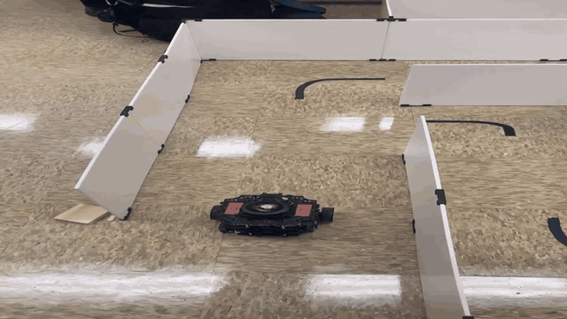
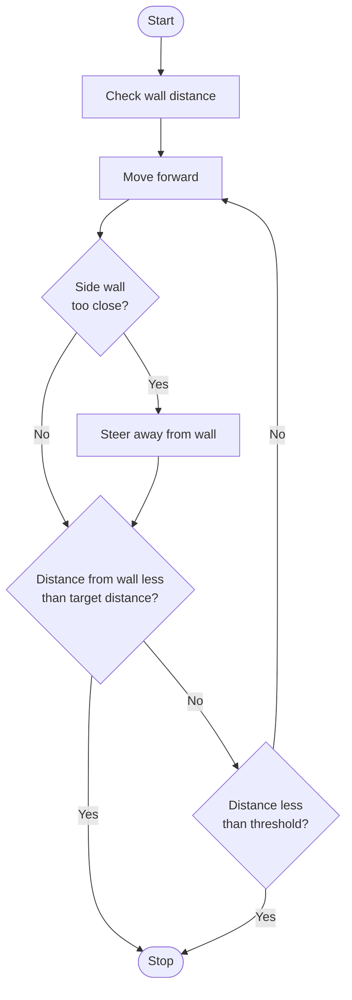
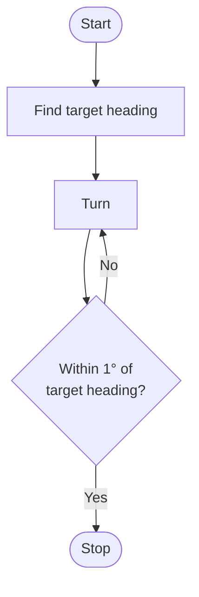

# Autonomous-Maze-Solver
**Author:** Joseph Pokuta & Raymond Nelson

**Course:** Robot Operating Systems (EE3280) | Michigan Technological University

**Date:** 12/05/25 (Updated 11/7/26)

Using ROS 2 (Jazzy) and a TurtleBot 3 to solve a predetermined 5x5 maze.

<div align="center">
  
  <br>
  <sup><strong>Demo:</strong> TurtleBot 3 solving the maze (sped up) · <a href="Media/maze-video.mp4">full-quality video</a></sup>
</div>

## About
Our first approach, inspired by the A* algorithm, had to be set aside as the time left in the project ran short.

The idea was to represent the maze as a grid that could be iterated over, exploring branching paths to find the shortest route between a start and end cell. That route would then be handed to the robot as a list of instructions, which it would follow using its LiDAR and IMU. Between the robot's hardware limitations and the project timeline, this proved very difficult to troubleshoot. We pivoted to hardcoding the forward-movement and turning functions, which let us program a predetermined path through the maze.

The pathfinding logic is still in the repository (`SampleLogic/A_Star.py`) and is run as part of `maze_solver.py`, but its output is not currently used to drive the robot.

> **Note:** Although it was inspired by A\*, the pathfinder we ended up with is functionally different. It is a depth-first search with backtracking: it walks the maze in a fixed direction order, saves branch points it passes, returns to them at dead ends, and keeps the shortest complete route it finds. It has no distance heuristic or open/closed set the way true A\* does.

## Control Logic
The robot's movement is built from two primitives: driving forward a set number of cells, and turning 90° in place.

### Forward Movement
The robot takes a LiDAR reading of the wall ahead, then drives forward until it has closed that distance by the target amount (0.42 m per cell) or gets within the safety threshold (0.25 m) of the wall. While driving, it also watches the side walls (LiDAR beams 30° left and right of center) and steers away from either one that gets too close. This added obstacle avoidance keeps the robot centered between the walls for more consistent results.



### Turning
The robot computes a target heading 90° left or right of its current IMU yaw, then rotates in place until it is within tolerance of that heading.



## Project Structure
* `maze_solver.py`: The main ROS 2 node, containing the multithreaded navigation logic, LiDAR processing, and IMU-based turning functions.
* `SampleLogic/A_Star.py`: The grid pathfinding logic. `maze_solver.py` imports it, and it can also be run on its own without ROS (`python3 SampleLogic/A_Star.py`).
* `Archive/`: The original, unrefactored versions of both scripts as they were at the end of the project, kept for reference.

## How to Run
1. Create a new Python package:
   ```bash
   ros2 pkg create --build-type ament_python autonomous_maze_solver
   ```
2. Copy `maze_solver.py` and `SampleLogic/A_Star.py` into the package's module folder (`autonomous_maze_solver/autonomous_maze_solver/`).
3. Register the node as an entry point in `setup.py`:
   ```python
   entry_points={
       'console_scripts': [
           'solver_node = autonomous_maze_solver.maze_solver:main',
       ],
   },
   ```
4. Add `rclpy`, `sensor_msgs`, `geometry_msgs`, and `std_msgs` as dependencies in `package.xml`, and make sure `numpy` is installed.
5. Build the workspace and source your ROS 2 and TurtleBot 3 environments.
6. Run the solver node:
   ```bash
   ros2 run autonomous_maze_solver solver_node
   ```
7. When prompted, enter the start and end cells. Cells are numbered 0–24, left to right and top to bottom, starting in the top-left corner.

### Note: Portability
This repository contains the core source code developed on an Ubuntu / ROS 2 Jazzy environment. The original workspace configuration (`package.xml`, `setup.py`) lived on a temporary boot drive and was not preserved, so the steps above recreate it. `maze_solver.py` contains the complete execution logic.

## Technical Challenges
The main challenge of this project was managing the complexity of the TurtleBot 3 hardware alongside the ROS ecosystem.
* **Concurrency:** `rclpy.spin()` blocks in an infinite loop. Since the node had to keep processing sensor data while the navigation functions ran, we used multithreading: the node spins in a background thread while the main logic executes.
* **System Architecture:** The entire program lives in a single Python script. A future improvement would be a more distributed ROS architecture, with separate nodes for sensing, planning, and acting.
* **Dead Reckoning:** The current solution relies heavily on odometry and the IMU, which led to inconsistent results. At times the robot's success felt like a coin toss due to accumulated sensor error.

## Limitations & Future Work
Our manual navigation method gave us a deep understanding of ROS and multithreading, but it also showed why robust pathfinding matters.

### Key areas for future development:
* **Refining A\*:** Reconnecting the grid-based pathfinding to the motion functions now that we have a stable understanding of ROS communication.
* **Sensor Fusion:** Better integration of LiDAR and odometry to reduce reliance on dead reckoning.
* **Modularization:** Breaking the project into a proper ROS package with launch files and separate configuration nodes.
